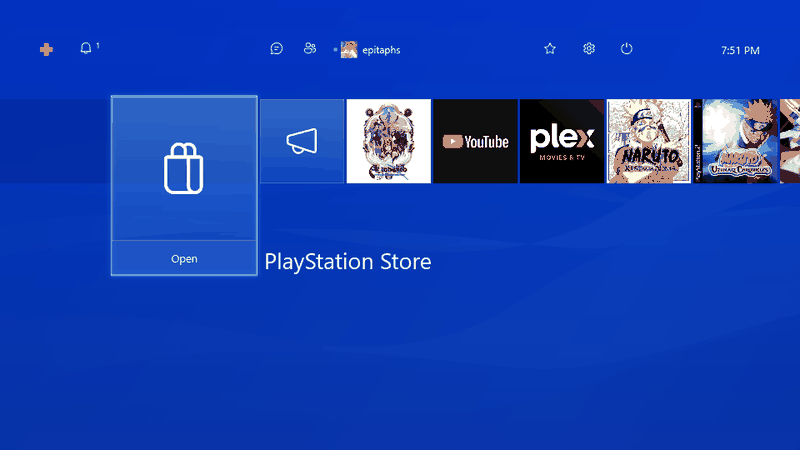
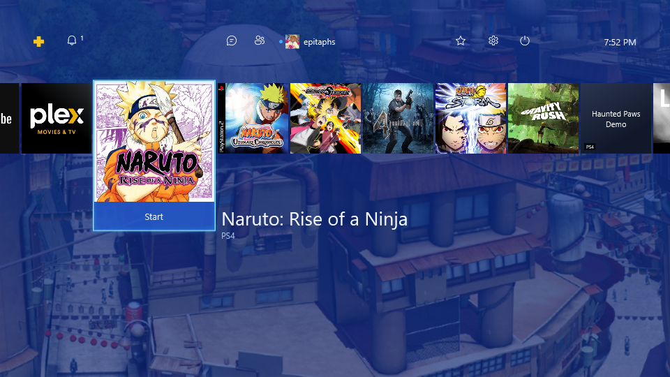
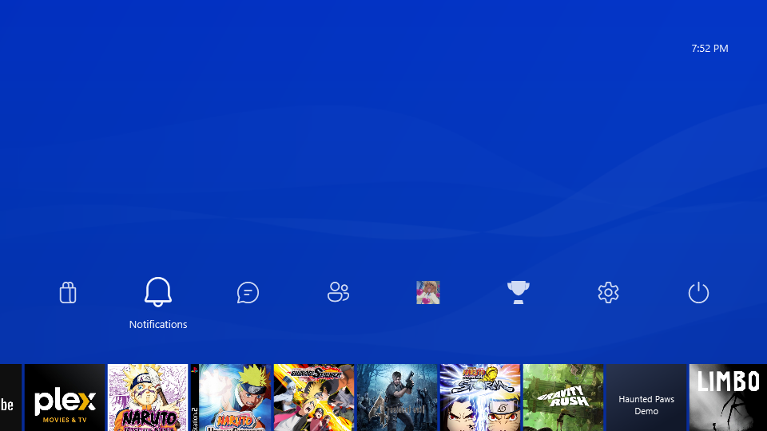
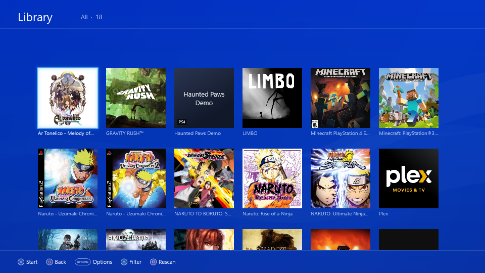
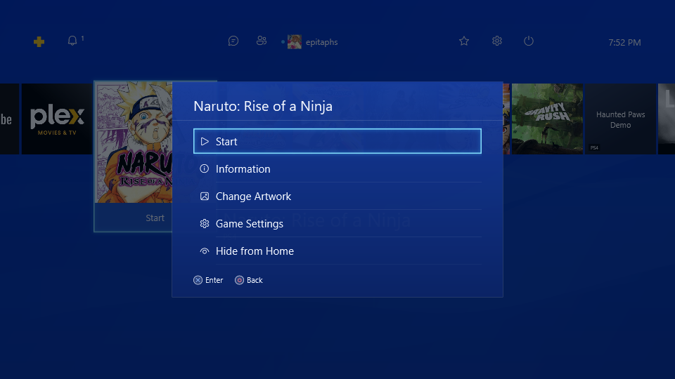

# OrbisUI

**A PlayStation 4 style home screen for Windows gaming handhelds.** OrbisUI turns a Windows PC, built and tuned for the ASUS ROG Ally, into something that looks, sounds and feels like a PS4: you pick up a DualShock 4, press the PS button and browse all your games from one console-style menu, without touching the Windows desktop.



**What it does**
- One library for everything: Steam games, other PC games and Microsoft Store apps, and PS1, PS2, PS3, PS4, PSP and Vita games through their emulators (DuckStation, PCSX2, RPCS3, shadPS4, PPSSPP, Vita3K).
- Square cover art fetched automatically, plus descriptions from the PlayStation Store.
- Press Start and the game launches fullscreen. The PS button brings you back home, even while a game or emulator is running.
- Controller first: native DualShock 4 support over USB or Bluetooth, no DS4Windows needed. Keyboard works too.
- Console-style extras: notifications, friends from Steam, trophies from RetroAchievements, a web browser, a file manager, Wi-Fi, audio and display settings, and a PS4 PKG installer.

It is a free, portable app (unzip and run, no installer) and a personal fan project. It is not affiliated with or endorsed by Sony Interactive Entertainment. No Sony files, firmware or games are included; you add your own sound and icon packs, BIOS files and games.

| | |
|---|---|
|  |  |
|  |  |

**Latest release:** [v0.4.8](https://github.com/knivesbatz/OrbisUI/releases/latest) · full feature status in [FEATURES.md](FEATURES.md) · roadmap in [TODO.md](TODO.md) and the [issues](https://github.com/knivesbatz/OrbisUI/issues).

## Features (implemented)

**Console experience**
- PS4 home: status bar (PS Plus, notifications, messages, friends, your Steam avatar and name, trophies, settings, power, clock), square tiles with the enlarged selection and Start bar; Up drops the row to the bottom and opens the function row like the console
- Trophies and Friends cards under the selected game: progress, grade counts, most recent trophy and friends' progress (Steam achievements or RetroAchievements)
; press Down for the game's full trophy list (icon, name, description, grade, date or Locked)
- PlayStation Store and What's New tiles; What's New is an activity feed of you and your Steam friends (friends need a Steam Web API key)
- Live video background, boot video that fades into home (PS skips it) and home music, from your own media in `Data\Media`
- PS4 sound pack and icon pack (your files; repaired WAV headers), colour themes like the console's (Settings > Themes, royal blue by default, also tints the boot video), everything square-cornered
- TV & Video folder: preview row, Down opens a 4-column app grid; apps added in Settings, renamed, with SteamGridDB or image-file art
- Built-in controller-friendly web browser (Google by default)
- File Manager in Settings: drives and folders, copy, move, rename, new folder, delete to the Recycle Bin
- PS4 PKG installer in the File Manager: games, updates and DLC extracted for shadPS4
- Friends and Messages: your Steam friends, who's online and what they're playing; Cross opens a chat in Steam
- Steam friends, chat, profile and store open in Big Picture; Steam starts in the background and goes back to minimized (with OrbisUI in front) when Big Picture closes
- Notifications (with a Downloads category), power menu, setup wizard, on-screen keyboard
- Function row with a Trophies preview, two-pane Friends screen, PS-shapes "Please wait" page and a "Who is using this controller?" login, as in the console's menu tour
- DUALSHOCK 4 named as on the console; its battery level shows in the notification when it connects
- OrbisUI takes focus back on its own when it starts and when a game or Steam page closes

**Games**
- Steam games and shortcuts, PC games from .exe, .lnk, .url or Microsoft Store apps, PS1/PS2/PS3/PS4/PSP/Vita games from one ROM folder, multi-disc grouping with a disc picker
- Game versions: add other exes, shortcuts or Store apps in Game Settings, then pick one before launch
- SteamGridDB artwork by default (retried after offline starts), controller cover picker, backgrounds after 5 s
- Library with a small platform badge on each tile (no platform filters or grouping)
- Launch splash: the game's blurred SteamGridDB background with a spinner, held until the game has focus; Steam games launch with Steam kept minimized; PS button returns home over a running game
- Uninstall or Delete in game Options with two confirmations (Steam, Store and registered uninstallers, otherwise the Recycle Bin); uninstalled games leave the library on their own
- Emulated and added games are added to Steam (with icon and SteamGridDB art) and launch through that shortcut, so they run with the Steam overlay; Vita games launch directly
- Emulators tuned for the Ally by default: Vulkan, no OSD, fast boot (BIOS and splash skipped) and 16:9/720p-class rendering for DuckStation, PCSX2, PPSSPP, RPCS3 and Vita3K, shadPS4 splash off; configs backed up first
- ReShade in every emulator (Vulkan layer, your shaders); shadPS4 pipeline cache and Bloodborne patches (skip intro, 60 FPS++)
- PlayStation Store metadata for PlayStation games; Trophies shows your RetroAchievements
- PCSX2 widescreen and no-interlace patches and DuckStation's widescreen hack on by default
- Per-game ReShade preset, Lossless Scaling auto-activation (runs hidden, no LS window) with a "PRO Mode Active" notification
- Controller Fixer: find and install PlayStation button prompt mods with backup and undo

**System**
- Settings styled after the PS4's, all native (no Windows Settings pages): Wi-Fi scan and connect, Bluetooth pairing, audio output and input, Power, Accessibility, Display (resolution, refresh rate, brightness, 15 s revert timer)
- Portable folder, DPAPI-encrypted keys, low idle CPU, GitHub auto-updater with SHA-256 checks
- SONYRESOURCES backup restore: a fresh OrbisUI finds a `SONYRESOURCES` folder inside it, beside it, or at `X:\SONYRESOURCES` / `X:\Sony\SONYRESOURCES`, brings in its emulators, firmware and media (existing files win), then installs the PS3 firmware silently

## Next update (TODO)
Only open work is listed here; everything shipped is under Features.
1. Bloodborne: install the base game and the 1.09 update (configs and patches are ready)
2. PSP test ROM is a .7z, which PPSSPP can't open; it runs once extracted to .iso
3. Minecraft (PS3) boots with firmware 4.92 but gameplay isn't confirmed yet, and PS3 shader compiling takes too long
4. Persona 3 FES (PS2) boots but no picture was captured yet
5. Gravity Rush (Vita): Vita3K runs it at 30 FPS but the screen stays black, even when launched directly
6. Texture packs: no trusted source to download them from (#27)

## Install (portable)

1. Download `OrbisUI-x.y.z-win-x64.zip` from [Releases](https://github.com/knivesbatz/OrbisUI/releases) and unzip it anywhere, for example `C:\OrbisUI` or a microSD card.
2. Run `OrbisUI.exe`. No installer or .NET runtime is needed; everything is inside the folder.
3. The first run opens the setup wizard. It checks Windows, the display, Steam, free space, the controller and the emulators, then asks for your folders and optional online keys.

Everything OrbisUI writes stays in its own folder:

| Folder | Contents |
|---|---|
| `Config\` | settings.json, library cache, encrypted API keys (`secrets.dat`, Windows DPAPI) |
| `Cache\` | square artwork, backgrounds, generated cue sheets |
| `Logs\` | `orbisui.log` (diagnostics) |
| `Data\Sounds`, `Data\Icons` | your console sound and icon packs (see below) |
| `Games\PS1` … `Games\VITA` | default ROM folders (the ROM folder can be moved in Settings) |
| `Emulators\PS1` … `Emulators\VITA` | optional place for emulators (existing installs are detected) |
| `Firmware\` | BIOS/firmware you dumped yourself |
| `Backups\` | copies of emulator configs taken before OrbisUI changed them |

### Sounds and icons

The public package contains no Sony media. Built-in tones and vector icons are used until you add your own:

* **Sounds:** in Settings > Sound and Screen > Import Sound Pack, pick a folder of `snd_*.wav` files (plus an optional `*Startup*.mp3`). A `UI Sounds` folder next to the app is picked up automatically.
* **Icons:** put PNG icons in `Data\Icons` (file names in [IconPack.cs](src/OrbisUI/UI/IconPack.cs)). An `Icons` folder next to the app is imported automatically.

## Controls

| DualShock 4 | Keyboard | Action |
|---|---|---|
| D-pad / left stick | Arrow keys | Move |
| ✕ | Enter / Space | Select, start a game |
| ○ | Esc / Backspace | Back |
| △ / OPTIONS | F3 / Tab | Game options (artwork, settings, hide, uninstall) |
| Up on the home row | Up | Function row: Store, Notifications, Messages, Friends, Profile, Trophies, Settings, Power |
| Down on TV & Video | Down | Its apps |
| L1 / R1 | Page Up / Down | Jump |
| PS button | Home | Home screen. While an emulator or PC game runs it brings the home screen back over the game |
| Touchpad (in DuckStation) | | Emulator pause menu |

## Games

* **Steam:** installed games and existing non-Steam shortcuts are found automatically and start through Steam, so the overlay works.
* **Emulated games:** put them in the ROM folder in subfolders `PS1`, `PS2`, `PS3`, `PS4`, `PSP`, `VITA` (any case), or add more folders in Settings > Library > Extra Game Folders. PS4 games are extracted folders with `eboot.bin`. Vita and PS3 digital titles are read from the emulators' own install folders. Multi-disc games appear once, and you choose the disc when starting.
* **Artwork:** SteamGridDB (with your free API key) overrides every other source. Without a key, art comes from the game package (PS4/PS3/Vita icons), Steam's cache, your PCSX2/DuckStation covers, libretro-thumbnails, the Steam Store and IGDB. Every tile is square, and odd shapes are padded over a blurred copy of themselves. Backgrounds come only from SteamGridDB and fade in after a game has been selected for 5 seconds. Press OPTIONS > Change Artwork to pick another SteamGridDB image with the controller.

## Emulators

| System | Emulator | Default launch |
|---|---|---|
| PS1 | DuckStation | `-batch -nogui -fullscreen -- "{rom}"` |
| PS2 | PCSX2 | `-batch -nogui -fullscreen -bigpicture -- "{rom}"` |
| PS3 | RPCS3 | `--no-gui --fullscreen "{rom}"` |
| PS4 | shadPS4 | `-g "{rom}" -f true` |
| PSP | PPSSPP | `--fullscreen --escape-exit "{rom}"` |
| Vita | Vita3K | `-F -r {id}` |

Arguments can be changed per system (Settings > Emulators) and per game (OPTIONS > Game Settings). If DuckStation has never been set up, OrbisUI writes an Ally profile so games boot straight in: 720p (3x), 16:9 widescreen hack, bilinear smoothing, no on-screen messages and DualShock 4 bindings. Any existing config is backed up first. Configs you already tuned keep everything except the Ally essentials (Vulkan, no OSD, fast boot), changed after a backup. PPSSPP, RPCS3 and Vita3K get a Vulkan, no-OSD, fullscreen starter config when they have none.

## Building

Requires the .NET 10 SDK on Windows.

```powershell
.\build.ps1             # tests + dist\OrbisUI-x.y.z-win-x64.zip (+ .sha256)
.\build.ps1 -Personal   # also a package that includes your local sound/icon packs (keep it private)
```

To test against a scratch data folder, set `ORBISUI_ROOT`. `ORBISUI_SCRIPT="wait:3000;Up;shot:fn;quit"` drives the UI and saves screenshots to `Logs\shots`.

## Updates

OrbisUI checks the [latest GitHub release](https://github.com/knivesbatz/OrbisUI/releases/latest) at startup and every 6 hours (Settings > System Software Update). Updates install only after the ZIP matches the SHA-256 published with it. Old files are kept as `*.old` until the next start and are rolled back if anything fails. `Config`, `Cache`, `Logs`, `Data`, `Games`, `Firmware`, `Emulators` and `Backups` are never touched.

## Troubleshooting

* **A game doesn't start:** the error is shown and logged in `Logs\orbisui.log`, including the exact command line.
* **Splash screen never goes away:** press ○ to stop waiting. The launcher gives up on its own after 90 seconds.
* **The controller does nothing:** check Settings > Controllers. SDL3.dll must sit next to OrbisUI.exe. The keyboard always works.
* **Wrong cover:** use OPTIONS > Change Artwork. △ searches SteamGridDB under another name.
